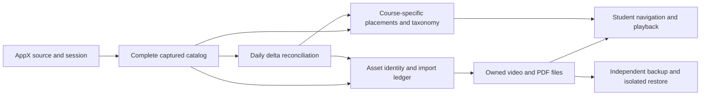

# Vidyagram — full sync remediation action map

**For whole-plan review only. Nothing will apply automatically.**

Production writes, deployments, queued repairs and in-flight mutations: **zero**. Local patches, tests, source reads and previews are preserved. The earlier 23-row transaction and PDF deployment were rejected by automatic approval review and never ran. The user's later direction independently holds every production action until this entire map is reviewed. Credential rotation remains deferred.

## The whole picture

The causes sit at different links in this chain. Fixing a lesson title cannot recover a video; an empty transfer queue cannot prove every current source asset has a job; copying to primary storage cannot prove independent recovery.

| Phase | Proposed work | Scope and prerequisite |
|---|---|---|
| 0. Establish the source and ownership baseline | Verify current session/listing, safely refresh only stale course96 after review, resolve absent-course policy, freeze source identity and imported/admin ownership. | Temporary read-only session use does not renew the production daily runner's stored session. Preserve courses148/149 and historical access while their absence is reviewed. |
| 1. Prevent the same failures | Review/test video source-pair selection, clear-PDF validation, source-managed placement reconciliation and namespace-aware taxonomy resolution. | Video and PDF patches are local; placement reconciliation is only a local prototype. None is deployed. |
| 2. Recover selected media | Two replacement assets/four occurrences; two current eligible PDF files; probe and select recoverable dead-video sources. | Never retry all183 dead jobs or old PDF ledger exceptions blindly. Media must be ready before its four placements become visible. |
| 3. Reconcile the complete structure graph | Titles, disabled/obsolete placements, free access, filing, coherent ordering and four case-collision groups, in one deduplicated plan. | Up to1,323 existing placement candidates plus four media insertions and five retained taxonomy aliases. These are preview ceilings, not an approved write count. Preserve six intentional test namespaces. |
| 4. Prove convergence and recoverability | Student playback/navigation/access, source-vs-destination re-audit, repeat bounded dry-run, later actual nightly observation, independent backup inventory/retention/restore. | No full-sync or recovery claim until these pass. Buyer/user/test/history parity remains a separate unresolved survey. |

Phases1 and2 can progress in parallel with structure design after Phase0 establishes the same source baseline. Do not let separate writers patch the same placement independently. Application would be stepwise only after the whole plan is reviewed.

## Counts without double-counting

- **Video:**183 dead jobs/Classes, of which133 have a current active planned asset and50 do not. The two missing replacement assets are outside this set.52 dead jobs previously received404;131 received no playable URL. Current links do not prove the provider can serve the bytes.
- **Source exceptions:**73 no-link video occurrences are separate from those183 current asset keys. The nightly `waitingOnLink:147` is a mixed, time-specific counter and must not be added. Awaiting recordings, no-link assets and import-time failures need separate labels.
- **External media:**1,215 YouTube Classes and300 external MP4/no-job Classes are not native-copy successes or the183 failed native jobs. Whether their bytes require independent copying is a policy decision.
- **PDF:**the raw ledger says12 failed and5 pending, but the current source-plan survey changes their interpretation: **two current eligible failed files need recovery;15 old file entries are disabled or superseded**. Do not retry those15 or claim their old statuses are current missing content. Nine old pending source attachments belong to that historical population.
- **Structure:**18 titles,9 activation pairs,1 free flag and50 filing differences overlap on **75 existing placement documents**. Coherent source ordering for five courses would change1,257 priorities; adding all field changes gives1,309 documents. Four taxonomy groups affect38 placements,24 overlapping filing; the combined ceiling is **1,323 existing placements**, not a sum of dashboard counts. Four new replacement placements are separate.
- **Protected namespaces:**six same-name Section pairs serve42,130 question documents and1,805 series references. They are intentional separate namespaces and are **not merge candidates**. Five aliases from the four actual case-collision groups may be retained only after alias-reader/reference behavior is validated.

These counts describe known snapshot candidates. Fresh source changes, later admin edits, held historical filing, reference checks and plan decisions can reduce or alter the eventual exact write set. Full per-ID lists and before/after fields are in the supporting plans and JSON.

## Read the detailed plans

- [Master dependencies, decisions and acceptance](plan.md)
- [Video jobs, replacements, failures and external media](media-video.md)
- [PDF files/notes, source capture, backup and restore](media-pdf-capture-backup.md)
- [All titles, visibility, filing, ordering and taxonomy actions](structure.md)
- [Exact structure action inventory](structure-actions.json)

Every proposed action in these plans records cause, scope or remaining scope discovery, source/admin ownership, dependencies, before/after effect, risk, rollback and acceptance. Unknowns are retained rather than filled with guessed fixes. The final authorized [bounded live-source survey](live-source-survey.md) is complete; the temporary handoff was deleted. It confirms all four Geometry occurrences and two PDF metadata rows, but course96 still returns502 and local student-tree access returns403. It does not establish a fresh full-catalog tree.

## Decisions to review together

1. Adopt source values only for demonstrably imported/source-owned fields; retain and surface operator edits. Review the larger **coherent five-course order normalization** rather than treating six inversions as six trivial edits.
2. Preserve the six question/test namespaces and historical IDs. Agree the alias/namespace contract before any taxonomy retirement; do not globally merge names.
3. Keep absent courses148/149 off-sale with existing historical access unless stronger source evidence and an agreed access policy justify changing that behavior.
4. Decide native-copy coverage for YouTube/external MP4, and identify the existing independent backup system/retention/access to inspect. No new storage or mass copy is silently included.
5. Agree whether omitted source provenance fields, deferred global Class renaming/batch-copy merging, standalone-PDF course visibility, and buyer/user/test/history parity belong in the next delivery scope. They are not certified by this catalog/media survey.

This is a review packet, **not a request to apply the 23-row batch**. All application remains held.
