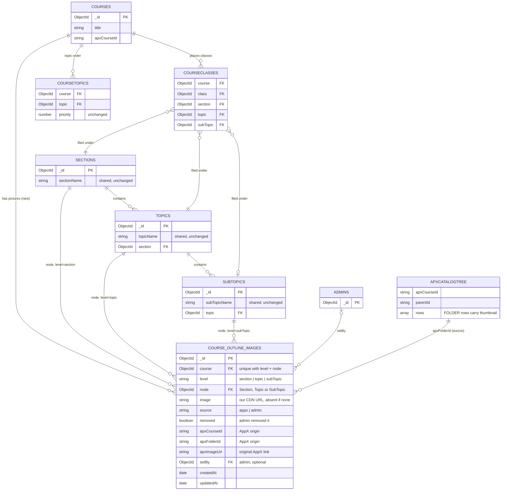

# PRD: Vidyagram course folder images

Status: ready-for-agent, drafted 2026-10-27 from the session that ran the mirror check (decisions below).
Vidyagram only (backend branch `vidyagram-admin`, admin branch `vidyagram-admin`). Nothing here ships to quicktricks.

**Phase 1 (now): bring the AppX pictures in.** Store, matcher, re-host, backfill and the nightly step (modules 1–5).
**Phase 2 (later, the user's call): show and edit them.** App read fields, app guide and admin editing (modules 6–8).
Phase 1 stores the data in the shape phase 2 needs, so phase 2 adds no migration. Decided 2026-10-27: one table for all
three levels, not pictures on `coursetopics` (a `coursetopics` row means "this course has a stored topic order").

## Problem Statement

On AppX, a course's Content tab shows every folder with its own picture: the gold % on "Percentage (प्रतिशत)", the
calculator on "Calculation Videos", the planner art on "BATCH PLANNER". Students find their chapter by that picture as
much as by its name. The AppX import carried every folder over as a section, topic or sub-topic of the course outline,
but it left the pictures behind. In Vidyagram the same course shows a column of plain rows, so it looks unfinished next to
the AppX app students used last week.

There is also no way to put a picture on a folder by hand. When an admin builds or edits a course, the outline rows
can't carry an image at all.

## Solution

Every section, topic and sub-topic of a course can carry an image, set per course. The same topic can look different in
two courses, just as it does in AppX.

- A one-time backfill copies each AppX folder picture onto the matching outline row of the matching Vidyagram course.
  The image is re-hosted on our CDN and never hotlinked from AppX.
- The nightly AppX sync keeps doing this until cutover, so a folder added or re-pictured in AppX shows up the next
  morning.
- Phase 2: the app gets an `image` on each section, topic and sub-topic in the course outline responses it already
  calls.
- Phase 2: admins can see, replace or remove the image on any outline row of a course. An admin's choice is final: the
  nightly never overwrites it. Phase 1 already honours that rule, so nothing changes when editing arrives.

Mirror check (2026-10-27, 10-19 snapshot, `reference/scripts/vidyagram-folder-image-map.cjs`): 7,798 of 10,833 AppX
folders carry an image. 4,071 of 4,170 topic and sub-topic rows have one AppX folder that maps onto them one-to-one.
The backfill would set 2,462 topic, 58 sub-topic and 104 section images. AppX course 103 (the screenshot that started
this) maps all 42 topic folders, each with its image.

## User Stories

1. As a student, I want each chapter in a course's Content tab to show the same picture it had on AppX, so that I find my chapter at a glance.
2. As a student, I want section rows to show their picture, so that the subject blocks of a big course stand apart.
3. As a student, I want sub-topic rows inside a chapter to show their picture when AppX had one, so that deep courses look the same as before.
4. As a student, I want a row with no picture to look the way it does today, so that nothing breaks or shows a broken-image icon.
5. As a student, I want the same chapter in two different courses to show each course's own picture, so that a course I bought looks the way its teacher designed it.
6. As a student, I want pictures to load fast from the same CDN as class thumbnails, so that the Content tab doesn't stall.
7. As a student, I want a folder the teacher adds in AppX tonight to show its picture tomorrow, so that the two apps don't drift while both are live.
8. As a student, I want a picture the teacher changes in AppX to change here too after the nightly run, so that I don't see a stale banner.
9. As a student, I want pictures to keep working after AppX is switched off, so that the course doesn't go blank at cutover.
10. As an app developer, I want `image` on each section, topic and sub-topic in `GET /api/topic-and-section`, so that I render the outline from the call I already make.
11. As an app developer, I want `image` on each entry of the `subTopic` list in `GET /api/topics/:topicId/classes`, so that the chapter screen can show sub-topic pictures.
12. As an app developer, I want `image` left out (not null, not empty) when a row has none, so that my existing "field missing" handling applies.
13. As an app developer, I want an app guide with a real response from a real course, so that I can build against it without guessing.
14. As an admin, I want to see each outline row's current image in the course outline screen, so that I know what students see.
15. As an admin, I want to upload a new image for one row of one course, so that I can fix a picture without touching other courses.
16. As an admin, I want to remove a row's image, so that a wrong picture stops showing.
17. As an admin, I want my replacement or removal to survive every nightly run, so that my fix isn't silently undone.
18. As an admin, I want to see whether a row's image came from AppX or from an admin, so that I know whether the nightly can still change it.
19. As an admin, I want to hand a row back to AppX (undo my override), so that it follows the AppX picture again.
20. As an admin, I want a new image to show in the app right after I save, so that I can check it on my phone.
21. As an admin, I want the upload to take the same image types and size limits as course banners, so that I don't learn a new rule.
22. As an admin, I want rows of courses built by hand (not from AppX) to accept images too, so that new courses can look as good as imported ones.
23. As an operator, I want a dry run that lists, per course, every row that would get an image and every AppX image that maps nowhere, so that I can check it before anything is written.
24. As an operator, I want the backfill to copy each AppX image to our CDN once, even when 40 courses use it, so that storage and run time stay small.
25. As an operator, I want the backfill to be safe to re-run, so that a crash halfway costs nothing.
26. As an operator, I want a ledger of every row the backfill or nightly set, with the AppX folder and URL it came from, so that I can trace or undo any image.
27. As an operator, I want an image AppX can't serve (404, timeout) to leave the row as it was and land in the report, so that one dead link doesn't stop the run.
28. As an operator, I want rows whose items come from more than one AppX folder to be left without an image and listed, so that we never guess a picture.
29. As an operator, I want the nightly step to touch only courses whose AppX tree changed that night, so that it adds little to the run.
30. As an operator, I want a switch that turns the nightly image step off, so that I can stop it without a deploy.
31. As an operator, I want the read path to add no extra round trip per row, so that `topic-and-section` stays as fast as it is.
32. As the client, I want the folder pictures I paid designers for on AppX to carry over, so that the migration doesn't lose my branding work.

## Implementation Decisions

### Rules settled in the 2026-10-27 session

- **Per course, all three levels.** An image belongs to (course, level, node), level = section | topic | sub-topic. The
  shared Section / Topic / SubTopic documents are never given an image.
- **Source = the student tree.** The AppX image is the `thumbnail` on FOLDER rows of the mirrored student tree
  (`apxcatalogtree`). No new AppX fetch is needed for the backfill.
- **Dropped and merged folders lose their image.** VIDEO / PDF / teacher / batch wrapper folders the planner dropped,
  and levels folded into a sub-topic, give no image. Only the folder that maps onto an outline row gives one.
- **One-to-one or nothing.** A row's source folder is the deepest folder holding all of the row's items, after climbing
  past VIDEO/PDF wrappers. The match counts only when that folder holds no item filed under another row. Otherwise the
  row gets no image and goes in the report.
- **Re-host, never hotlink.** Images are copied onto the Vidyagram class-thumbnail CDN (the same bucket and client the
  class thumbnail backfill uses). The object key is derived from the AppX URL, so one AppX image is stored once and a
  changed AppX image gets a new key (no stale CDN cache).
- **Admin wins.** An admin-set image or removal is never overwritten by the backfill or nightly. "Use AppX image"
  clears the override; the next nightly run fills the row again.
- **Nightly until cutover.** The nightly AppX sync runs the image step after its placement step.

### Modules

1. **Folder image matcher** (deep, pure). Input: one course's mirrored student-tree pages, plus the course's outline
   rows, each with the AppX row ids of the items placed under it (classes now; PDFs once course PDF placement lands).
   Output: per outline row, either `{ level, nodeId, apxFolderId, apxImageUrl }` or a reason it has none (`no folder`,
   `shared folder`, `folder has no image`). Also lists the image-bearing AppX folders that map to no row. No DB, no
   network. This is the rule behind the dry-run script, moved into the backend and tested.
2. **Outline image store.** A new collection, one document per (course, level, node), unique on that triple. Fields:
   `image` (our CDN URL, absent after a removal), `source` (`appx` | `admin`), `removed` (admin removal), AppX
   provenance (`apxCourseId`, `apxFolderId`, `apxImageUrl`), who set it and when. Interface: `imagesForCourse(courseId)`
   → a lookup keyed by level and node id; `setFromAppx(rows)` skips admin rows; `setByAdmin`, `removeByAdmin`,
   `returnToAppx`. Index built by hand (`autoIndex: false`, `commitQuorum: 'majority'`), like the other Vidyagram
   index scripts.
3. **Image re-host.** `rehost(apxUrl)` → our CDN URL. Stable key from the URL, skips the upload when the object
   already exists, keeps a per-run memo, rejects non-image responses. A failed fetch returns a failure instead of
   throwing.
4. **Backfill command.** Dry run by default: per course it runs the matcher against the mirror and live placements and
   writes a report (rows to set, rows skipped with reason, unmapped AppX images, re-host count). `--commit` re-hosts
   and calls `setFromAppx`. The store's AppX provenance fields are the ledger (no separate ledger collection); each run
   also saves its report file. Idempotent; resumable by course.
5. **Nightly step.** After placement, for courses whose tree pages changed in the run: matcher → re-host →
   `setFromAppx`. A changed AppX URL replaces an `appx` image; a vanished folder clears an `appx` image. Off switch:
   env `APX_FOLDER_IMAGES_NIGHTLY` (default on once deployed).
Modules 6–8 are phase 2: built later, when the user decides to show the pictures.

6. **Read decoration.** `GET /api/topic-and-section?courseId=` adds `image` on each section, topic and sub-topic.
   `GET /api/topics/:topicId/classes?courseId=` adds `image` on each entry of its `subTopic` list. One `imagesForCourse` read per
   request, merged in memory. The field is omitted when there is no image.
7. **Admin API and UI.** Admin routes on the course: list outline images, set (upload via the existing admin image
   upload flow), remove, return to AppX. The course outline screen shows a thumbnail per row with Replace / Remove /
   Use AppX image, and a small "AppX" or "Admin" label.
8. **App guide.** `vidyagram/reference/vidyagram-folder-images-app-guide.md`, written from real calls on a real course
   (AppX 103).

### Schema

One new collection, `course_outline_images`. No existing collection changes: Section / Topic / SubTopic stay shared
and imageless, and CourseClass / CourseTopic are untouched. `node` points at a Section, Topic or SubTopic depending on
`level`; the unique key is (`course`, `level`, `node`).

### Wire shapes

`GET /api/topic-and-section?courseId=…`: each section, topic and sub-topic object gains
`"image": "https://<vidyagram cdn>/781/course-outline/<key>.jpeg"` when set. Nothing else changes.

Admin, all `requireAdmin`, under the course:
- `GET …/outline-images` → `[{ level, nodeId, name, image?, source, removed, apxImageUrl? }]`
- `PUT …/outline-images/:level/:nodeId` `{ image }` → the row, `source: admin`
- `DELETE …/outline-images/:level/:nodeId` → the row, `removed: true`, `source: admin`
- `POST …/outline-images/:level/:nodeId/use-appx` → clears the override; `appx` image restored at once when the ledger
  has it, else on the next nightly run

`level` is `section` | `topic` | `subTopic`; a node that isn't in this course's outline returns 404.

## Testing Decisions

A good test drives a module through its public interface with realistic inputs and checks what a caller sees: matcher
verdicts, stored rows, API JSON, uploads made. It never asserts on private helpers or query shapes, so the internals
can change freely.

- **Matcher (unit).** Small hand-built trees: a topic folder holding VIDEO + PDF wrappers maps to the topic; a topic
  whose items all sit in the VIDEO wrapper still maps to the real folder (the bug the dry run hit); a folder shared by
  two topics maps to neither; a section with several topic folders maps to its subject folder only when that folder
  holds nothing else; a folder with no `thumbnail` gives "folder has no image"; image-bearing wrappers are reported
  unmapped. One fixture cut from AppX course 103 checks all 42 topics.
- **Store (integration, mongodb-memory-server, phase 1).** Same topic in two courses keeps two images;
  `imagesForCourse` returns only that course's rows by level and node; `setFromAppx` never touches an `admin` row
  (seeded directly in the test, since phase 1 has no admin route); the unique key refuses a second row for the same
  course, level and node.
- **Read API (integration, phase 2).** Each course's `topic-and-section` shows its own images; no row → field absent;
  sub-topic image appears in topic classes; the response is otherwise byte-identical to today's.
- **Backfill + nightly (integration).** Re-run is a no-op; admin image and admin removal survive a nightly run; a
  changed AppX URL replaces an `appx` image; a vanished folder clears it; the off switch stops the step.
- **Re-host (unit, fake storage).** The same AppX URL twice → one upload; an existing object → no upload; a 404 or
  non-image response → failure value and nothing stored.

Prior art: the Vidyagram class thumbnail backfill tests (image-first candidate rule, re-host to a new key), the
nightly placement step tests on the nightly branch, the catalogue capture integration tests on mongodb-memory-server,
and the class-tabs / NEW-tag tests for `topic-and-section` response shape.

## Out of Scope

- Quicktricks. Its AppX folders have the same field, but this PRD ships to Vidyagram only.
- Folders the planner dropped or merged (4,645 VIDEO/PDF wrappers and 115 others in the 10-19 snapshot).
- Picking an image for the 99 rows whose items come from more than one AppX folder; admins can set those by hand.
- Generating images (AI Banner Studio) or frame-grabs for rows AppX left blank.
- Course-level banners and class thumbnails, which are already imported.
- PDF-only rows such as "BATCH PLANNER": they appear in the outline only once course PDF placement (onboarding task
  09) lands. The matcher takes PDF items as input already, so the next nightly after that fills them.

## Further Notes

- The 10-19 snapshot predates some AppX folders ("Digital Sum" in course 103 is missing). The commit backfill reads
  the live mirror, not the snapshot.
- Many courses reuse one AppX image (the "Calculation Videos" picture appears in about 40). Keying re-hosts by URL
  keeps that to one object.
- The old dry-run script stays as the offline cross-check: the backfill's dry-run totals should match its numbers on
  the same data.
- After the phase 1 deploy: update the memory note `vidyagram-folder-banners`. The app guide goes to the app team in
  phase 2.
- Topic and section drags keep working unchanged: they write `coursetopics` order only, and pictures never read or
  write ordering. A section has no stored order of its own; it sits where its first topic sits.
