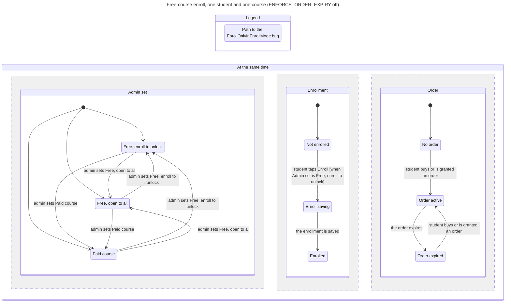

# Free-course enroll: statechart and TLA+ check

One student and one course, checked with TLC against the reader's rules for the free-course enroll feature
([PRD](../../plans/free-course-enroll.md)). Ground truth is the backend worktree
`~/Projects/worktrees/vg-free-enroll-backend`, branch `feat/vg-free-enroll` at `10125d5a3` (the deployed build).
Analysis only. Nothing here touched a database or a box.

## Verdict

| | `ENFORCE_ORDER_EXPIRY` off (the default; unset on the quicktricks box) | `ENFORCE_ORDER_EXPIRY` on |
|---|---|---|
| States / steps TLC reached | 27 / 108 | 27 / 108 |
| Open: everyone plays (`OpenPlays`) | holds | holds |
| Open: never in My Courses (`OpenNotListed`) | holds | holds |
| Enroll: plays only with enrollment or order (`EnrollPlays`) | holds | holds |
| Enroll: Free tab exactly when enrollment or order held (`EnrollTab`) | holds | **breaks** (expired order) |
| Paid: plays only with order, enrollment never grants (`PaidPlays`) | holds | holds |
| Paid: Paid tab exactly when order held, enrollment never lists (`PaidTab`) | holds | **breaks** (expired order) |
| Tab is decided by the mode (`TabFollowsMode`) | holds | holds |
| Nothing deletes an enrollment (`EnrollmentKept`) | holds | holds |
| Flip back to enroll restores the old enrollment (`FlipBackRestores`) | holds | holds |
| An enrollment is written only in enroll mode (`EnrollOnlyInEnrollMode`) | **breaks** (race) | **breaks** (race) |
| No deadlock | holds | holds |

The Vidyagram box's `ENFORCE_ORDER_EXPIRY` value was not read, because this task does not connect to boxes.
The quicktricks box has it unset, according to `reference/postman/global-search-classes.README.md`.

## Bug paths (shortest, from TLC)

**1. `EnrollOnlyInEnrollMode`: an enrollment can be written into a Paid or Open course.** Both configs, 3 steps:

0. Free, enroll to unlock · Not enrolled · No order
1. student taps Enroll → the call reads the course and sees enroll mode (`courseEnrollment.ts:30-32`)
2. admin sets Paid course → saved between the read and the write
3. the enrollment is saved → the upsert (`courseEnrollment.ts:33-37`) does not read the mode again. It writes
   the row and returns 200 `enrolled` on a Paid course.

This is harmless. The stray row grants nothing and lists nothing while the course is Paid or Open: the class
rule takes enrollments only for enroll-mode placements (`classAccessAuthz.ts:127-128`), the course rule does
the same (`:247`), and My Courses uses `ENROLL_MODE_MATCH` (`courseController.ts:2565`). If the admin flips back
to enroll, the student is unlocked, exactly as if the tap had landed a second earlier. No fix is needed. The
model checks the rule only because the brief said "only succeeds in enroll mode".

**2. `PaidTab` (expiry on): a Paid course stays in the Paid tab after its order expires, but it is locked.** 2 steps:

0. Paid course · Not enrolled · No order
1. student buys or is granted an order → plays, Paid tab
2. the order expires → **locked, still in the Paid tab**

**3. `EnrollTab` (expiry on): an enroll course stays in the Free tab after its order expires, but it is locked.** 2 steps:

0. Free, enroll to unlock · Not enrolled · No order
1. student buys or is granted an order (an AppX ₹0 `free_course*` order, say) → plays, Free tab
2. the order expires → **locked, still in the Free tab**

Paths 2 and 3 have one cause. My Courses lists from `myCourseCandidateIds`, which ignores expiry by design
("Being listed here means the user once held the course", `myCourses.ts:13-14`, `courseController.ts:2602`).
Play goes through `courseScopeFromOrders`, which drops an expired order when the flag is on
(`courseScope.ts:95-96`, reached from `classAccessAuthz.ts:138` and `:257`). Path 2 is old Paid-tab behaviour.
Path 3 is the same behaviour carried into the new Free tab. An enrolled student is not affected: enrollments
have no expiry. With the flag off, an expired order still plays, and both rules hold.

## Where the code and the brief's rules disagree

- `courseEnrollment.ts:30-37`: the mode check and the write are two calls (path 1). Harmless, as shown above.
- `myCourses.ts:13-14` together with `courseScope.ts:95-96`: listing ignores expiry, playback honours it. The
  two disagree only when `ENFORCE_ORDER_EXPIRY` is on (paths 2 and 3).
- Nothing else. `courseFreeMode.ts:14-15`, `authorizeClassAccess` (`classAccessAuthz.ts:96-144`),
  `authorizeCourseAccess` (`:233-270`) and `getUserCourses` (`courseController.ts:2543-2566`, `2651-2656`)
  match every other rule.

## Code vs model: replayed in memory

`replay/replay.ts` runs the real backend functions with Mongo reads and writes stubbed on the model objects
(nothing connects). It covers all 36 combinations of mode × enrolled × order × expiry flag. Each combination
goes through `authorizeCourseAccess`, `authorizeClassAccess`, `myCourseCandidateIds`, the two `$match` objects
and the tab split, and the result is compared with the model's `CanPlay` and `Tab`.
**Result: 0 mismatches.** It also replays path 1 on `enrollInCourse` (the row is written while the course is
Paid, and the call returns `enrolled`) and paths 2 and 3 (locked, still listed). Output: `replay/replay.out`.

What the student sees, according to the code (`replay.out`). "expired" plays only when the flag is off:

| Mode | Enrolled | Order | Plays | My Courses |
|---|---|---|---|---|
| Paid | any | none | no | none |
| Paid | any | active | yes | Paid |
| Paid | any | expired | flag off: yes / on: **no** | Paid |
| Open | any | any | yes | none |
| Enroll | no | none | no | none |
| Enroll | no | active | yes | Free |
| Enroll | no | expired | flag off: yes / on: **no** | Free |
| Enroll | yes | any | yes | Free |

## Statechart (`ENFORCE_ORDER_EXPIRY` off)

Rendered: [`expiry-off/chart.svg`](expiry-off/chart.svg). With the flag on: [`expiry-on/chart.svg`](expiry-on/chart.svg).
In the flag-on chart, "Free, enroll to unlock", "Paid course", every Enrollment state and "Order expired" carry
the orange mark: in some combinations they break `EnrollTab` or `PaidTab`.



The chart has three parallel regions: what the admin set, and the student's two holdings. What the student
sees is derived from them, as in the table above. A fourth region for it made start combinations that never
happen, and the chart fell back to 93 arrows. The chart hides no steps itself. It does not draw the 15 steps
that stay in one state: the 409 `NOT_ENROLLABLE` and the repeat tap, which change nothing.

## What the model leaves out

- A class's own free flags. `Class.isFree` and a free `CourseClass` placement open the class to everyone in
  any mode (`classAccessAuthz.ts:110, 122`). The PRD keeps that "as today". The model assumes neither is set.
- A class placed in several courses: any placement that opens it wins. The model has one course.
- Course Builder partial builds (chapter scope), plan grants and retired plans, admin-deleted orders
  (`status: 0`), an admin caller, an inactive course (enroll answers 404, `courseEnrollment.ts:30-31`).
- The other readers of the mode: timetable `effectiveIsFree`, `isEnrolled` on cards, `isPaid`, the search
  `canPlay` hint, certificates.
- Order revoke and refund. The model has buy, expire and renew only.

## Files and how to make them again

- `FreeCourseEnroll.tla`: the model; derived outputs cite file:line. `FreeCourseEnroll.cfg` (flag off) and
  `FreeCourseEnrollExpiry.cfg` (flag on).
- `view.mjs`: chart words. `expiry-off/`, `expiry-on/`: `report.md`, `chart.mmd`, `chart.svg`, `tlc.out`,
  and `tlc-EnrollOnlyInEnrollMode.out` (the property counterexample).
- `replay/replay.ts`, `replay/replay.out`: code-vs-model replay.
- `render-svg.mjs`, `marks.css`: the Pele render, from the statechart skill's `references/render.md`.

From this folder, with a new `--out`:

```bash
SC=~/.claude/plugins/cache/pstack-claude/pstack/0.9.112/skills/statechart/scripts/statechart
$SC FreeCourseEnroll.tla --config FreeCourseEnroll.cfg --view view.mjs --out /tmp/fce-off
ENFORCE_EXPIRY=1 $SC FreeCourseEnroll.tla --config FreeCourseEnrollExpiry.cfg --view view.mjs --out /tmp/fce-on
```

Replay (read-only; uses the worktree's `ts-node`):

```bash
W=~/Projects/worktrees/vg-free-enroll-backend; W=$W TS_NODE_PROJECT=$W/tsconfig.json TS_NODE_TRANSPILE_ONLY=1 $W/node_modules/.bin/ts-node replay/replay.ts
```

SVG: copy `render-svg.mjs` and `marks.css` into a folder that has `npm i pele@1.9.0`, then run
`node render-svg.mjs <path>/chart.mmd`.
